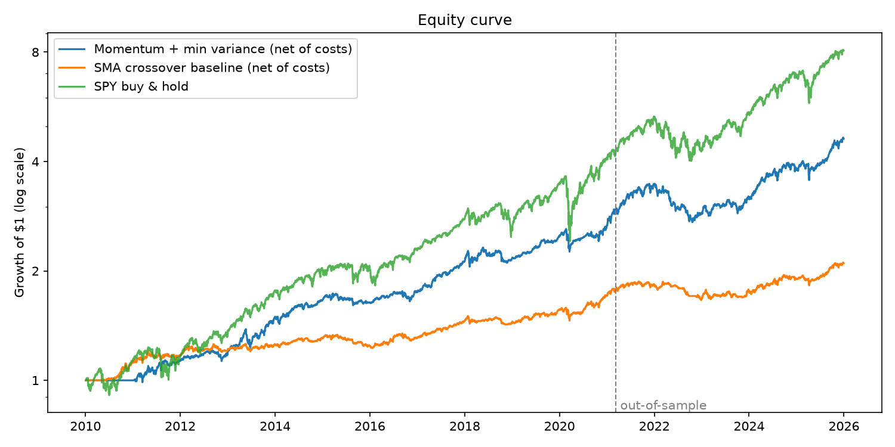
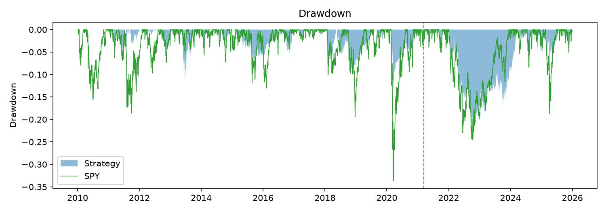

# quant-momentum-backtester

A small vectorized backtester I wrote in Python to test momentum strategies on
a basket of ETFs, with transaction costs and an out-of-sample test.

The current strategy holds the 5 ETFs (out of 10) with the strongest momentum
and weights them to minimize portfolio variance. Over 2010-2025 it has a
Sharpe of 1.08 after costs, against 0.85 for SPY. Out-of-sample it is 0.87,
about the same as SPY, with lower returns and lower risk. Details and caveats
below.

## What it does

1. Downloads adjusted daily closes for 10 ETFs from Yahoo Finance
   (US/foreign stocks, bonds, gold, commodities, real estate).
2. Ranks them by momentum and keeps the top 5.
3. Weights those 5 with long-only minimum variance.
4. Lags positions by one day and charges a cost on every change in position.
5. Chooses the settings on the first 70% of the data and reports results on
   the last 30%, next to SPY buy-and-hold and my earlier SMA strategy.

## Strategy

Based on *Adaptive Asset Allocation: A Primer* (Butler, Philbrick, Gordillo,
Varadi, 2012): rank assets by momentum, keep the top half, and weight them
with minimum variance.

**Momentum score.** Average of the trailing 3, 6, 9 and 12 month returns:

```
score_i(t) = mean over L in {63, 126, 189, 252} of  P_i(t) / P_i(t-L) - 1
```

**Selection.** Keep the 5 assets with the highest score.

**Weights.** Minimum variance on the 60-day covariance matrix `C` of those 5:

```
minimize  w' C w   subject to  sum(w) = 1,  w >= 0
```

Without the `w >= 0` constraint the solution is `w = C^-1 1 / (1' C^-1 1)`.
To keep it long-only I solve that, drop the asset with the most negative
weight, and repeat until nothing is negative (`src/strategies.py`).

**Tranches.** Capital is split into 4 equal portfolios. Each one rebalances
every 20 trading days, staggered 5 days apart. See "Rebalance timing luck"
below for why.

**Position and net return.**

```
position(t) = w(t-1)                      # trade on yesterday's weights
net(t) = sum_i position_i(t) * r_i(t) - cost * sum_i |position_i(t) - position_i(t-1)|
```

Default cost is 5 bps per unit of turnover.

## Results

Data: 2010-01-04 to 2025-12-30 (4,023 trading days). In-sample is the first
70% (through 2021-03-11), out-of-sample is everything after.

|               | Strategy IS | Strategy OOS | Strategy full | SMA baseline OOS | SPY OOS | SPY full |
|---------------|------------:|-------------:|--------------:|-----------------:|--------:|---------:|
| Annual return |       10.2% |         9.6% |         10.1% |             3.4% |   14.0% |    14.0% |
| Annual vol    |        8.3% |        11.3% |          9.3% |             6.3% |   17.1% |    17.2% |
| Sharpe        |        1.21 |         0.87 |          1.08 |             0.56 |    0.85 |     0.85 |
| Sortino       |        1.67 |         1.22 |          1.49 |             0.78 |    1.23 |     1.19 |
| Max drawdown  |      -13.5% |       -21.6% |        -21.6% |           -11.2% |  -24.5% |   -33.7% |





How I read this:

- **The out-of-sample Sharpe (0.87) is the number to trust**, not the
  full-period 1.08. Eleven of the sixteen years are in-sample, which is where
  the settings were chosen.
- **Out-of-sample it roughly matches SPY on a risk-adjusted basis** (0.87 vs
  0.85) but it does not beat SPY on return (9.6% vs 14.0%). What it offers is
  about two thirds of the volatility.
- **It is a clear improvement on my first strategy**, the SMA crossover, which
  got 0.56 out-of-sample.
- **2022 hurt.** The strategy lost 16.7% that year. Stocks and bonds fell
  together, and "the top 5 by momentum" still means holding 5 things when
  everything is falling. There is no rule that moves to cash.
- **The Sharpe drop from 1.21 to 0.87 is expected.** Some of it is choosing the
  best of 8 settings in-sample, some of it is 2022.

### Robustness

Full-period Sharpe under different assumptions:

| Assumption                       | Sharpe |
|----------------------------------|-------:|
| As reported (1-day lag, 5 bps)   |   1.08 |
| No lag (lookahead, wrong)        |   1.12 |
| Trade one day late (2-day lag)   |   1.04 |
| 10 bps costs                     |   1.03 |
| 20 bps costs                     |   0.94 |

### Rebalance timing luck

If I run a single portfolio that rebalances every 20 days, the in-sample
Sharpe depends on which day I happen to start:

| First rebalance on day | 0    | 5    | 10   | 15   | 4 tranches (what I use) |
|------------------------|-----:|-----:|-----:|-----:|------------------------:|
| In-sample Sharpe       | 1.22 | 1.08 | 1.04 | 1.33 |                    1.21 |

Nothing about the strategy changes between those columns, so the spread is
luck. Splitting into 4 staggered tranches averages it out instead of letting
me (accidentally or not) pick the lucky one.

## How I got here

I'm keeping this because the failed attempts are part of the result.

1. **SMA crossover (v1).** Long an ETF when its 20-day average is above its
   100-day average, sized by inverse volatility. In-sample Sharpe 0.93,
   out-of-sample 0.56. Worse than SPY.
2. **More trend rules.** I tried 114 variations (other moving averages,
   3/6/12-month momentum, weekly and monthly rebalancing). The best
   out-of-sample Sharpe of any of them was 0.88 and the median was 0.53.
   In-sample rank had basically no relationship to out-of-sample rank
   (rank correlation 0.03), so tuning these parameters harder was pointless.
3. **Back to in-sample data only.** From here on I only looked at 2010 to
   March 2021 while designing.
   - RSI dip-buying (mean reversion): Sharpe between 0.1 and 0.5 after costs.
     Too much trading for too little edge at daily frequency.
   - Volatility targeting and asset-class risk parity on top of the trend
     rules: no real improvement (about 0.9 to 1.0).
   - Momentum ranking + minimum variance weights: better (about 1.0 to 1.2).
     The minimum variance step is what helped. It pairs stocks with bonds
     when they hedge each other instead of just shrinking whatever is volatile.
4. **Caught a lucky result.** With the paper's settings and month-end
   rebalancing the in-sample Sharpe was 1.40. Rebalancing on the 1st, 5th,
   10th or 15th trading day of the month instead gave 1.14, 1.08, 0.98 and
   0.90. Same strategy, so 1.40 was mostly luck. That is why I use tranches.
5. **One out-of-sample run** of the final design: 0.87.

The experiments in steps 2 to 4 were scratch work and are not all in this
repo. `main.py` reproduces the final pipeline, the settings grid, the
robustness table and the timing table.

## Things I was careful about

- **Lookahead bias.** Weights computed at the close of day *t* are only held
  from day *t+1*. The tests change future prices and check that past weights
  and returns don't move (`test_momentum_minvar_no_lookahead`,
  `test_sma_strategy_no_lookahead`).
- **No backfilling.** Missing prices are forward filled only. Backfilling
  copies later prices backwards.
- **Overfitting.** Settings are ranked on in-sample data only and the grid is
  small (8 combinations of momentum lookbacks and covariance window). The
  top-5-of-10 rule and 6-month momentum as a starting point come from the
  paper, not from tuning.
- **Costs.** Charged on all turnover, including the min-variance reweighting.

## Limitations

- **The out-of-sample test is not perfectly clean.** I had already seen
  out-of-sample results for the SMA variants (step 2) before designing the
  current strategy, so I knew roughly what 2021-2025 looked like.
- **Risk-free rate is 0.** With a 3% risk-free rate (closer to 2022-2025) the
  out-of-sample Sharpe is about 0.60 for the strategy and 0.67 for SPY.
- **One out-of-sample window is one sample.** 0.87 over under five years has
  wide error bars.
- **16 years is short for a monthly-ish strategy**, and 2010-2021 was an
  unusually good period for both stocks and bonds.
- A flat bps cost ignores market impact and wider spreads in stress periods.
- I picked 10 ETFs that exist today and have long histories.
- Daily closes only. Assumes I can trade at the close.
- The first year (2010) is warm-up with no positions. It is included in the
  metrics as zeros.

## Run it

```bash
python -m venv .venv
source .venv/bin/activate
pip install -r requirements.txt

python -m pytest          # tests
python main.py            # backtest, writes results/
```

## Layout

```
src/data_loader.py   download + clean prices
src/indicators.py    SMA, RSI, rolling vol, momentum score, inverse-vol weights
src/strategies.py    SMA trend strategy, min variance, momentum + min variance
src/backtester.py    the backtest itself + IS/OOS split
src/metrics.py       Sharpe, Sortino, drawdown, etc.
tests/               unit tests
main.py              runs everything
```
